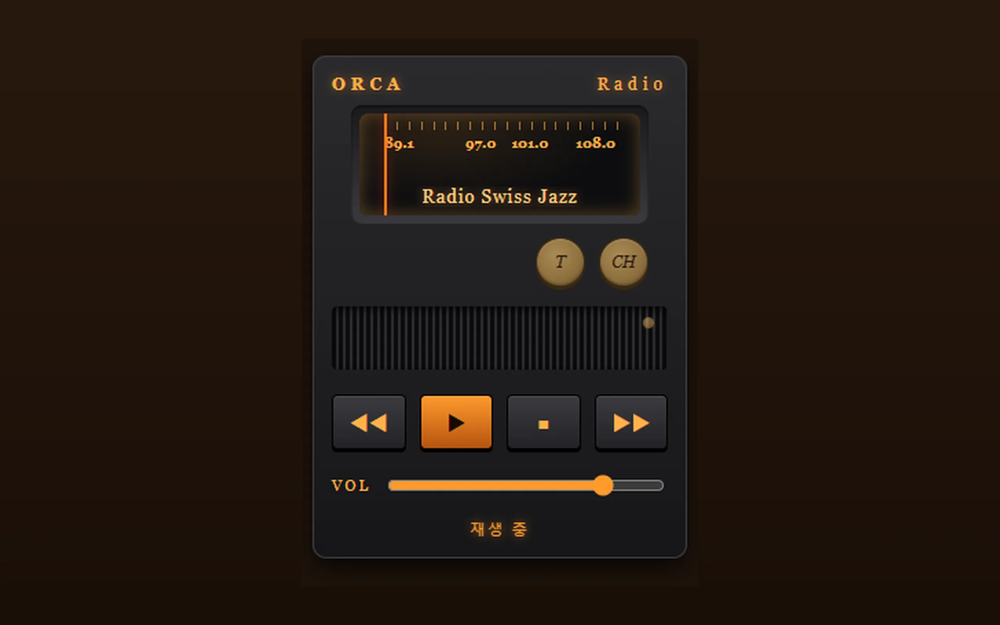
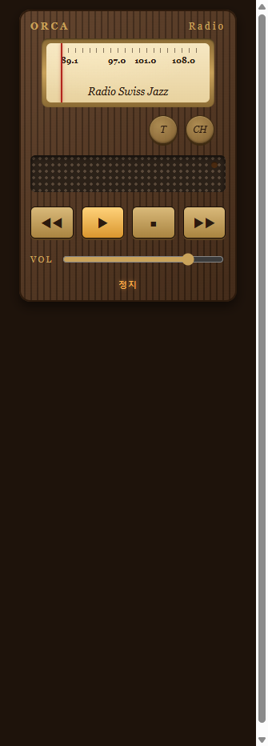
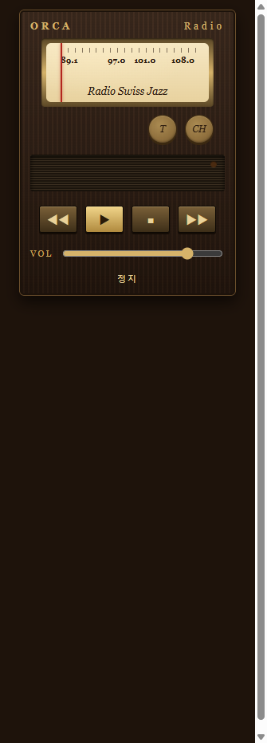
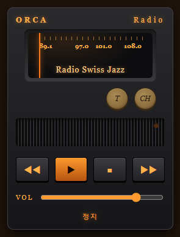
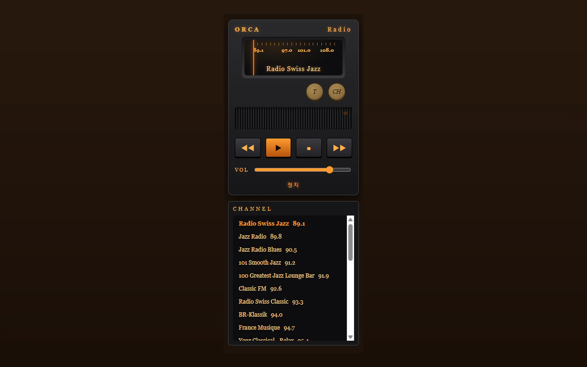

# Radio for Orca

[**English**](README.md) | 한국어

Orca 사이드바에서 인터넷 라디오를 듣는 플러그인입니다. 옛날 라디오 모양의 패널에서 주파수 눈금으로 방송을 고르고, 재생, 정지, 볼륨을 조절합니다.

## 화면



| 디자인 A (황동) | 디자인 B (월넛) | 디자인 C (차콜) |
| --- | --- | --- |
|  |  |  |



## 기능

- **주파수 눈금**: 89.1 ~ 108.0 MHz 눈금에서 현재 방송의 위치를 바늘로 표시합니다.
- **CH 목록**: `CH` 버튼을 누르면 방송 목록이 아래로 펼쳐지고, 항목을 고르면 바로 재생합니다.
- **재생 조작**: 이전 채널, 재생, 정지, 다음 채널, 볼륨. 버튼은 원형 베이클라이트와 황동 링 모양입니다.
- **ON AIR 램프**: 재생 중에는 다이얼 창 오른쪽 아래의 램프가 켜집니다.
- **디자인 3종**: `T` 버튼으로 A(빈티지 황동, 기본), B(하이파이 월넛), C(레트로 차콜)를 바꿉니다. 고른 디자인은 기억합니다.
- **언어 7개**: 영어, 한국어, 일본어, 독일어, 스페인어, 프랑스어, 러시아어. 브라우저 언어를 따르고, `F2`로 바꿀 수 있습니다. 고른 언어는 기억합니다.
- **도움말**: `Ctrl+H`로 단축키 목록을 열고 닫습니다. `Esc`나 클릭으로도 닫힙니다.

## 조작

| 키 | 동작 |
| --- | --- |
| ← / → | 이전 / 다음 방송 |
| Space | 재생 / 정지 |
| ↑ / ↓ | 볼륨 올리기 / 내리기 |
| F2 | 언어 바꾸기 |
| Ctrl+H | 도움말 열기 / 닫기 |
| Esc | 도움말이나 채널 목록 닫기 |

키보드 조작은 입력 칸(볼륨 슬라이더 포함)에 포커스가 없을 때 동작합니다.

## 요구 사항

- Orca 1.4.246 이상
- **Windows** 에서 테스트했습니다.
- **mpv** 가 설치되어 있어야 합니다. 워커는 `C:\Program Files\MPV Player\mpv.exe` 또는 `C:\Program Files\mpv\mpv.exe` 의 절대 경로만 씁니다. PATH 에서는 찾지 않으며, 둘 다 없으면 재생하지 않고 오류를 표시합니다.

## 권한 사용 목적

이 플러그인은 **전체 권한(Full access)** 을 요청합니다. 이유는 다음과 같습니다.

- **다른 프로그램 실행**: 재생을 위해 mpv 를 워커가 실행합니다. 이 플러그인이 띄운 mpv 만 끝냅니다.
- **네트워크**: 방송 스트림 주소에서 음악을 받습니다. 주소 목록은 `src/stations.ts` 에 있습니다.
- **파일 읽기**: 플러그인 자신의 파일과 설정만 읽습니다. 사용자 파일은 건드리지 않습니다.
- **데이터 수집 없음**: 사용 기록이나 개인 정보를 보내지 않습니다.

## 설치 (개발용)

```text
orca plugin dev load .
```

처음 불러오면 승인 지문이 나옵니다. `--approve <지문>` 을 붙여 다시 실행합니다. 파일을 바꾸면 지문이 바뀌므로 다시 승인합니다.

테스트:

```text
node --test tests/logic.test.ts tests/i18n.test.ts
```

## 구조

| 경로 | 내용 |
| --- | --- |
| `orca-plugin.json` | 매니페스트 (`trusted-worker`, 패널 `radio`, 워커 `src/worker.ts`) |
| `panel/` | 패널 화면 (`index.html`, `style.css`, 테마 `themes/`, 디자인 전환 `theme.js`) |
| `src/panel.ts` | 패널 로직 (주파수, 채널, 버튼, 키보드, 상태 표시) |
| `src/worker.ts` | 재생 워커 (mpv 실행, 정지, 볼륨, 상태 조회) |
| `src/logic.ts` | 순수 계산과 입력 검증 (바늘 위치, 주소, 볼륨) |
| `src/i18n.ts` | 7개 언어 문자열과 언어 선택 |
| `src/stations.ts` | 방송 목록 (이름, 스트림 주소, 주파수) |
| `tests/` | 단위 테스트 (`logic`, `i18n`) |
| `docs/` | 구조, 개발, 디자인, 방송국, 할 일 문서 |

자세한 내용은 [docs/README.md](docs/README.md) 를 보세요.

## 알려진 제한

- **재생은 워커가 띄운 mpv 가 맡습니다.** 패널의 `<audio>` 는 Orca 샌드박스에서 외부 스트림이 차단되어 쓰지 않습니다.
- **일부 방송 주소는 막혀 있을 수 있습니다.** SomaFM 주소는 확인 시점에 HTTP 403 을 받았습니다. Jazz Radio Blues 는 http 주소라서 https 로 열린 패널에서 막힐 수 있습니다.
- **주파수는 임의 배치입니다.** 방송 목록을 0.7 MHz 간격으로 나눠 놓은 값이고, 실제 방송 주파수가 아닙니다.
- **방송 목록은 복사본입니다.** herdr-radio 의 목록이 바뀌어도 자동으로 반영되지 않습니다.
- **mpv 정리**: 재생과 정지 때 `--title=orca-radio` 가 붙은 mpv 를 모두 끝냅니다. 다른 mpv(herdr-radio 등)는 건드리지 않습니다.

## 프로젝트 후원

이 프로젝트가 도움이 되었다면 개발자에게 커피 한 잔 후원을 고려해 주세요.

[](https://ko-fi.com/dev_ohyt)

## 라이선스

MIT. [LICENSE](LICENSE) 를 보세요.
