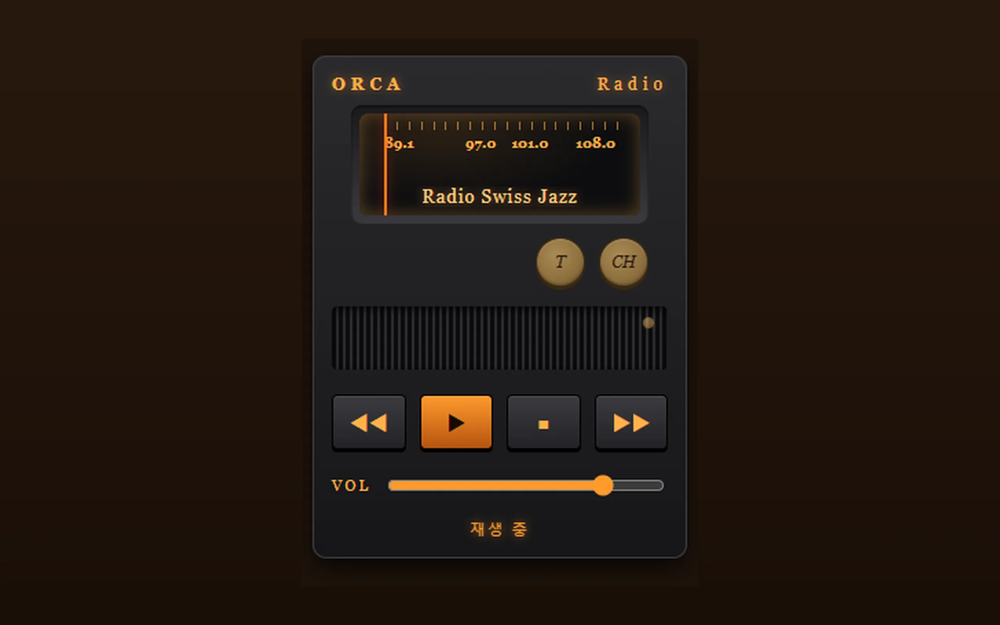
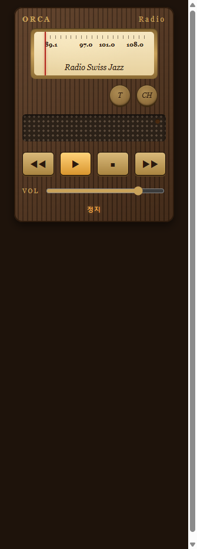
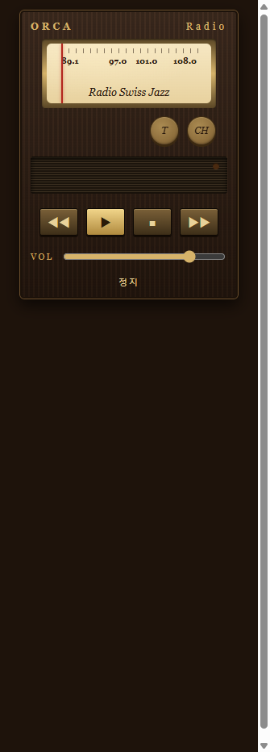
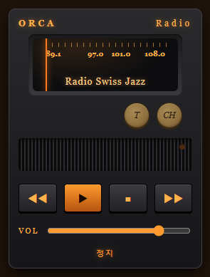
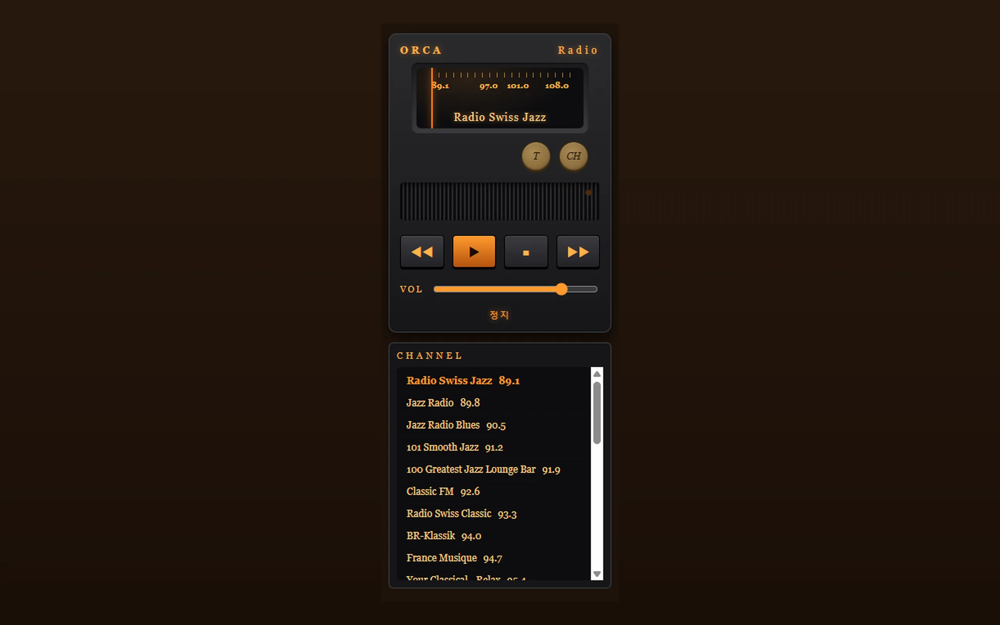

# Radio for Orca

English | [**한국어**](README.ko.md)

An Orca plugin for listening to internet radio from the sidebar. The panel looks like an old radio: pick a station on a frequency dial, then play, stop, and adjust the volume.

## Screenshots



| Design A (brass) | Design B (walnut) | Design C (charcoal) |
| --- | --- | --- |
|  |  |  |



## Features

- **Frequency dial**: a needle shows the current station's position on a 89.1–108.0 MHz scale.
- **CH list**: press `CH` to open the station list below the radio; choose an entry to start playing it.
- **Playback controls**: previous channel, play, stop, next channel, volume. The buttons are round bakelite with brass rings.
- **ON AIR lamp**: the lamp at the lower right of the dial lights up while playing.
- **Three designs**: press `T` to switch between A (vintage brass, default), B (hi-fi walnut), and C (retro charcoal). The choice is remembered.
- **Seven languages**: English, Korean, Japanese, German, Spanish, French, Russian. The browser language is used by default; press `F2` to change it. The choice is remembered.
- **Help**: press `Ctrl+H` to open the shortcut list. Close it with `Ctrl+H`, `Esc`, or a click.

## Controls

| Key | Action |
| --- | --- |
| ← / → | Previous / next station |
| Space | Play / stop |
| ↑ / ↓ | Volume up / down |
| F2 | Change language |
| Ctrl+H | Show / hide help |
| Esc | Close help or the channel list |

Keyboard controls work when no input field (including the volume slider) has focus.

## Requirements

- Orca 1.4.246 or later
- Tested on **Windows**.
- **mpv** must be installed. The worker uses only the absolute paths `C:\Program Files\MPV Player\mpv.exe` or `C:\Program Files\mpv\mpv.exe`. It does not search PATH. If neither exists, playback is refused and an error is shown.

## Why it asks for full access

The plugin requests **Full access**, for these reasons:

- **Running a program**: the worker starts mpv for playback. It only ends mpv processes it started (`--title=orca-radio`).
- **Network**: audio is streamed from the station URLs listed in `src/stations.ts`.
- **Files**: only the plugin's own files and settings are read. Your files are not touched.
- **No data collection**: no usage data or personal information is sent.

## Development

```text
orca plugin dev load .
```

The first load prints an approval fingerprint. Run again with `--approve <fingerprint>`. Changing files changes the fingerprint, so approve again.

Tests:

```text
node --test tests/logic.test.ts tests/i18n.test.ts
```

## Structure

| Path | Contents |
| --- | --- |
| `orca-plugin.json` | Manifest (`trusted-worker`, panel `radio`, worker `src/worker.ts`) |
| `panel/` | Panel UI (`index.html`, `style.css`, themes in `themes/`, design switch `theme.js`) |
| `src/panel.ts` | Panel logic (dial, channels, buttons, keyboard, status) |
| `src/worker.ts` | Playback worker (start, stop, volume, status of mpv) |
| `src/logic.ts` | Pure calculations and input checks (needle position, URL, volume) |
| `src/i18n.ts` | Strings for seven languages and language selection |
| `src/stations.ts` | Station list (name, stream URL, frequency) |
| `tests/` | Unit tests (`logic`, `i18n`) |
| `docs/` | Architecture, development, design, stations, todo |

See [docs/README.md](docs/README.md) for details.

## Known limitations

- **Playback runs in an mpv process started by the worker.** The panel's `<audio>` element is not used because Orca's sandbox blocks external streams.
- **Some station URLs may be unreachable.** SomaFM returned HTTP 403 when checked. Jazz Radio Blues uses http, so it may be blocked in an https panel.
- **Frequencies are assigned arbitrarily** at 0.7 MHz steps and do not match real broadcast frequencies.
- **The station list is a copy.** Changes to herdr-radio's list are not picked up automatically.
- **mpv cleanup**: on play and stop, every mpv with `--title=orca-radio` is ended. Other mpv processes (such as herdr-radio's) are left alone.

## License

MIT. See [LICENSE](LICENSE).
